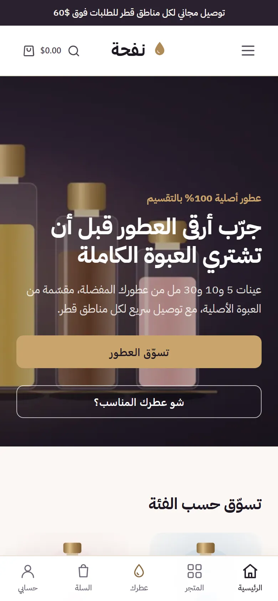
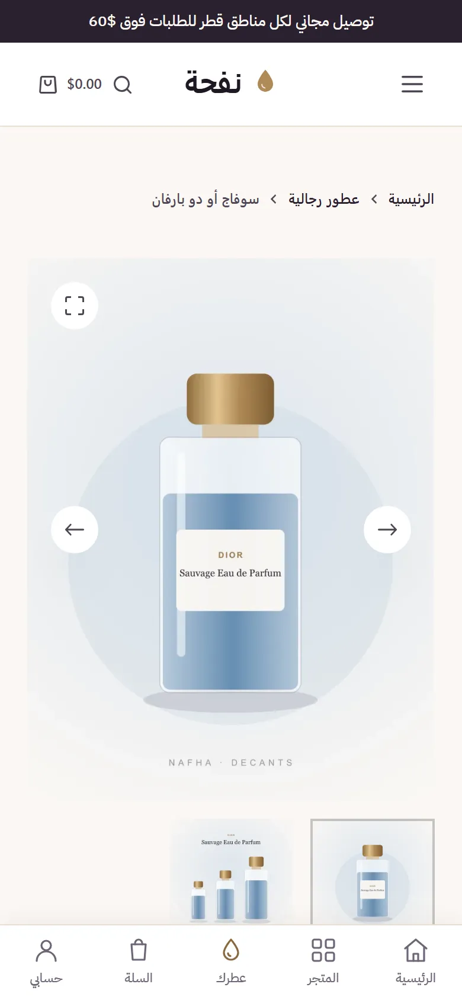
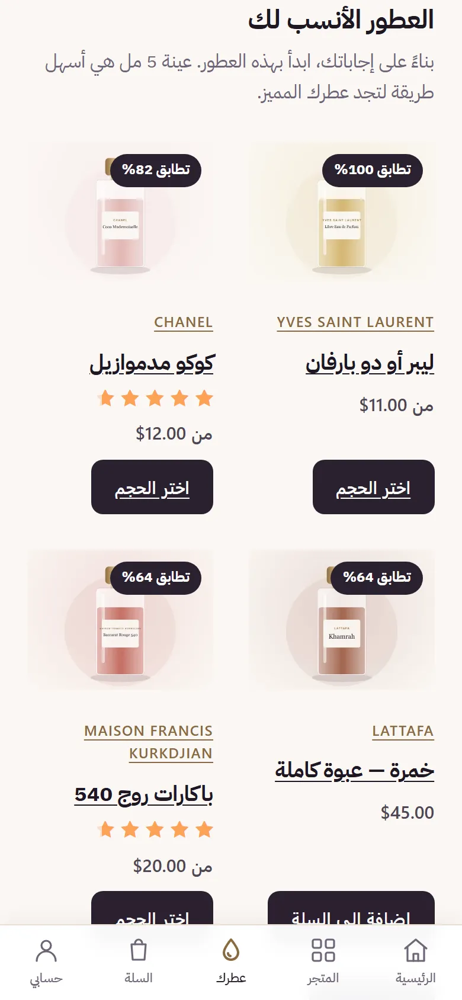
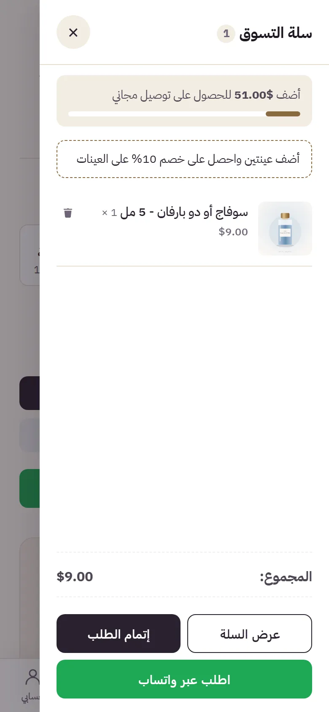
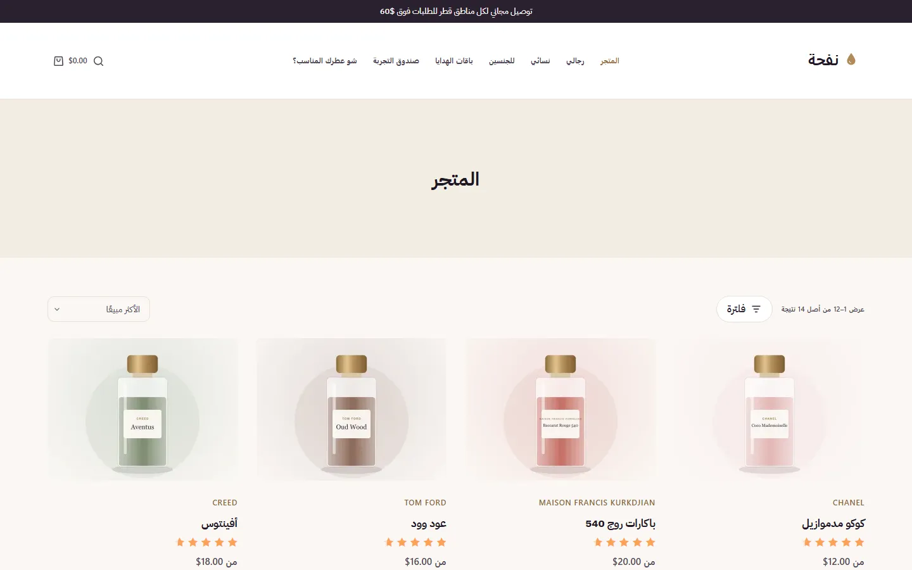

# Nafha | نفحة — perfume decant store

An Arabic (RTL), mobile-first WooCommerce store for perfume decants — 5/10/30 ml samples split from original bottles, full bottles and gift sets — with delivery across Qatar.
Built on WordPress + WooCommerce + Blocksy, with a custom plugin (`nafha-core`) instead of a stack of third-party plugins.

**Live:** [nafha.great-site.net](https://nafha.great-site.net) · Requirements: [docs/requirements.pdf](docs/requirements.pdf) · Plan: [docs/PLAN.md](docs/PLAN.md)

| Home | Product | Fragrance quiz | Side cart |
|---|---|---|---|
|  |  |  |  |

### Highlights
- **Size buttons with live per-size price**, stock warnings, fragrance profile (notes, longevity, sillage).
- **AJAX filters** with live counts, and **Arabic-aware search** (spelling variants, English names, brand aliases, notes).
- **"Which perfume suits you?" quiz** with match percentages, **discovery box** builder (3 or 5 samples, tiered discount).
- **Short checkout** for Qatar (areas drive delivery price, phone validation to `+974…`), cash on delivery, and **order via WhatsApp** (order saved, then WhatsApp opens with the full summary).
- **Side cart** with a free-delivery progress bar, photo reviews, GTM + GA4 e-commerce events with Consent Mode v2, product feed for Google/Meta.
- **Quality:** Lighthouse mobile 90 performance / 100 accessibility, SEO, best practices; 24 Playwright end-to-end tests on WebKit (iPhone), Chromium (Android) and desktop; every string translated (checked automatically).

### Stack
WordPress 7.1 · WooCommerce 11.2 · Blocksy + child theme · PHP 8.2 · Rank Math · Cloudflare Turnstile · Playwright · Lighthouse

## Local environment (XAMPP)
| | |
|---|---|
| Site | http://localhost:8080 (Apache vhost `C:\xampp\apache\conf\extra\perfume-store.conf`) |
| Admin | http://localhost:8080/nafha-login/ — credentials in `.local-credentials.txt` (git-ignored) |
| DB | MariaDB `perfume_store`, user `root`, no password |
| WP-CLI | `tools/wp.sh <command>` (from Git Bash) |

Start services: run XAMPP Control Panel → start **Apache** and **MySQL**.

## Code layout
- `public/` — WordPress install (core is not committed)
- `public/wp-content/themes/nafha-child/` — child theme of Blocksy (presentation only)
- `public/wp-content/plugins/nafha-core/` — store features (custom fields, WhatsApp order, quiz, side cart, tracking…)
- `docs/` — requirements, plan, [deployment checklist](docs/DEPLOY.md), [free hosting guide](docs/DEPLOY-FREE.md), plugin list, [bulk import guide](docs/IMPORT-GUIDE.md) + sample CSV

## Common commands (Git Bash, from the project root)
| Task | Command |
|---|---|
| Apply store configuration | `tools/wp.sh eval-file tools/setup/store-setup.php` |
| Regenerate demo images | `(cd tools && npm install && npm run images)` |
| Import / update demo products | `tools/wp.sh eval-file tools/setup/demo-products.php` |
| Write home page + static pages (OVERWRITES page content — run once) | `(cd tools && node images/hero.js)` then `tools/wp.sh eval-file tools/setup/content.php` |
| Rebuild the product search index | `tools/wp.sh nafha reindex` |
| Lighthouse (mobile) on key pages | `tools/lighthouse.sh <label>` |
| Check Arabic translations are complete | `/c/xampp/php/php.exe tools/check-translations.php` |
| Browser tests (iPhone/WebKit, Android/Chromium, desktop Chromium; `npx playwright install` once) | `(cd tools && npx playwright test -c e2e --project=webkit-iphone --project=chromium-android --project=chromium-desktop)` |
| Scan pages for untranslated words | `(cd tools && node e2e/i18n-scan.js)` |
| Remove e2e test orders + reset demo stock | `tools/wp.sh eval-file tools/e2e/cleanup.php` |
| Portfolio screenshots → `docs/screenshots/` | `(cd tools && node e2e/screenshots.js)` |
| Build the upload package for the live site → `dist/` | `tools/deploy/build.sh https://site [admin-email]` |

Local e-mails are not sent: `mu-plugins/nafha-local-mail.php` saves them to `wp-content/uploads/nafha-mail/` (only when `WP_ENVIRONMENT_TYPE` is `local`).

Demo products are flagged with `_nafha_demo` — see the header of `tools/setup/demo-products.php` for the one-line removal before launch.

## Custom features (nafha-core)
| Module | What it does |
|---|---|
| `class-qatar-areas.php` | Qatar municipalities as checkout areas (drive shipping zones) |
| `class-shipping.php` | Hides paid rates once free shipping applies; `free_shipping_min()` reads the threshold from the zones |
| `class-settings.php` | WooCommerce → Settings → Nafha (WhatsApp number, GTM, consent bar, box / sample discount rules) |
| `class-fragrance-profile.php` | "Fragrance profile" product tab: notes, longevity, sillage, English name, video |
| `class-variation-buttons.php` | Size buttons with per-size price (replaces the dropdown) |
| `class-whatsapp.php` | "Order via WhatsApp" button with product/size/qty/price message |
| `class-product-page.php` | Stock indicator, "From $X" prices, similar / you-may-also-like logic |
| `class-review-photos.php` | Optional photo on reviews (validated, held for moderation) |
| `class-shop-filters.php` | Off-canvas filters with live counts, active-filter chips, sorting options |
| `class-cart.php` | Side cart (opens on add-to-cart / cart icons), free-shipping progress bar, cart WhatsApp button |
| `class-checkout.php` | Short checkout (name, mobile, area, address, notes), phone validation + normalisation to +974…, no terms checkbox |
| `class-whatsapp-gateway.php` | "Confirm via WhatsApp" checkout method: order saved on-hold, then WhatsApp opens with the full summary |
| `class-quiz.php` | Fragrance quiz `[nafha_quiz]`: 6 questions, server-side scoring, match % on product cards |
| `class-offers.php` | Discovery box builder `[nafha_discovery_box]` (discounted box of 3/5 decants) and sample quantity discount |
| `class-reviews-showcase.php` | `[nafha_reviews]` — latest real 4–5★ reviews for the home page |
| `class-import-export.php` | "Brands" column for the product CSV importer/exporter |
| `class-seo.php` | Product schema name/alternateName fix on top of Rank Math |
| `class-tracking.php` | GTM container, GA4 e-commerce dataLayer events, Consent Mode v2 + consent bar ([docs/TRACKING.md](docs/TRACKING.md)) |
| `class-product-feed.php` | Google Merchant / Meta Catalog feed at `/feed/nafha-products/` |
| `class-performance.php` | jQuery chain to footer, inline small CSS, LCP image priority, WebP thumbnails, no emoji/unused assets |
| `class-search.php` | Normalised product search index (Arabic variants, English names, brands + aliases, notes); `wp nafha reindex` |
| `class-translation-gaps.php` | Arabic for the few Blocksy/WooCommerce strings missing from their language packs (screen-reader labels) |
